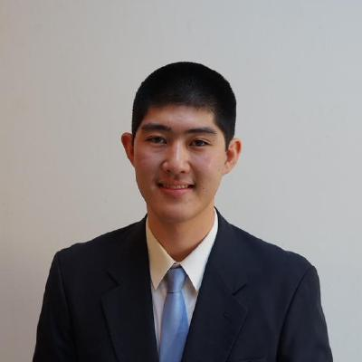

#+title: Yoshiki Takashima
#+Author: Yoshiki Takashima
#+HTML_HEAD: <link rel="stylesheet" type="text/css" href="css/imagine.css" />
#+HTML_HEAD_EXTRA: 
#+OPTIONS: toc:nil num:nil html-style:nil

#+ATTR_HTML: :alt Picture of me (Yoshiki Takashima).
#+ATTR_HTML: :text-align center

* Hi!
  I am a Post-Doctoral Associate at Yale Law School building AI
  systems that reason about the law.

  /Contacts:/
  - Email: yoshiki.takashima@yale.edu
  - Office: 127 Wall St. 400G, New Haven, CT 06511.
  - You can also find me on: [[https://github.com/YoshikiTakashima][Github]] and [[https://www.linkedin.com/in/yoshiki-takashima-480726146][LinkedIn]].

* Current and Past Positions
  - *Post-Doctoral Associate* ~ Yale Law School (May 2024 -)
    - Advised by Prof. [[https://law.yale.edu/scott-j-shapiro][Scott J. Shapiro]].

  - *PhD in Electrical and Computer Engineering* ~ Carnegie
    Mellon University: (August 2019 - March 2024)
    - Co-Advised by: Prof. [[http://www.andrew.cmu.edu/user/liminjia/][Limin Jia]] and Prof. [[https://www.andrew.cmu.edu/user/pcorina/][Corina Pasareanu]].

  - *BS Mathematics - Computer Science* ~ UC San Diego (2017 - 2019)
    - GPA: 3.95/4.00
    - /Note/: This is a (non-double) math major. A more precise description
      might be "Applied Mathematics, Application: Computer Science."

  - *IGETC Transfer Certificate* ~ Santa Monica College (2015 - 2017)
    - GPA: 3.85/4.00

* Publications
"+" denotes equal contribution.
  - *Scheherazade: Evaluating Chain-of-Thought Math Reasoning in LLMs
    with Chain-of-Problems*. Stephen Miner+, Yoshiki Takashima+, Simeng
    Han, Sam Kouteili, Ferhat Erata, Ruzica Piskac, Scott
    J. Shapiro. NeurIPS 2025 Math-AI
    Workshop. https://arxiv.org/abs/2410.00151
  - *VERT: Verified Equivalent Rust Transpilation with Large Language
    Models as Few-Shot Learners*. Aidan Z. H. Yang+, Yoshiki
    Takashima+, Brandon Paulsen, Josiah Dodds, Daniel
    Kroening. IEEE/ACM International Conference on Automated Software
    Engineering (ASE 2025) https://arxiv.org/abs/2404.18852v2
  - *CourtReasoner: Can LLM Agents Reason Like Judges?* Sophia Simeng
    Han, Yoshiki Takashima, Shannon Zejiang Shen, Chen Liu, Yixin Liu,
    Roque K. Thuo, Sonia Knowlton, Ruzica Piskac, Scott J Shapiro,
    Arman Cohan. Proceedings of the 2025 Conference on Empirical
    Methods in Natural Language Processing (EMNLP 2025)
    [[https://doi.org/10.18653/v1/2025.emnlp-main.1787]]
  - *Crabtree: Rust API Test Synthesis Guided by Coverage and
    Type*. Yoshiki Takashima, Chanhee Cho, Ruben Martins, Limin Jia,
    Corina Pasareanu. Object Oriented Programming Language
    (OOPSLA'2024) https://doi.org/10.1145/3689733
  - *Testing and Verifying Rust's Next Mile*. Yoshiki
    Takashima. Ph.D. Thesis. March 2024. https://doi.org/10.1184/R1/25451383.v1
  - *Automatically Enforcing Rust Trait Properties*. Twain Byrnes,
    Yoshiki Takashima, Limin Jia. International Conference on
    Verification, Model Checking, and Abstract Interpretation (/VMCAI
    2024/). https://doi.org/10.1007/978-3-031-50521-8_10
  - *PropProof: Free Model-Checking Harnesses from PBT*. Yoshiki
    Takashima. ACM Joint European Software Engineering Conference and
    Symposium on the Foundations of Software Engineering
    (/ESEC/FSE 2023/) [[https://doi.org/10.1145/3611643.3613863][https://doi.org/10.1145/3611643.3613863]]
  - *Mariposa: Measuring SMT Instability in Automated Program
    Verification*. Yi Zhou, Jay Bosamiya, Yoshiki Takashima, Jessica
    Li, Marijn Heule, Bryan Parno. Formal Methods in Computer-Aided
    Design (/FMCAD 2023/). See [[https://kilthub.cmu.edu/articles/report/Mariposa_Measuring_SMT_Instability_in_Automated_Program_Verification_Technical_Report_/23905905][tech report]].
  - *SyRust: Automatic Testing of Rust Libraries with Semantic-Aware
    Program Synthesis.* Yoshiki Takashima, Ruben Martins, Limin Jia,
    and Corina S. Păsăreanu. In Proceedings of the 42nd ACM SIGPLAN
    International Conference on Programming Language Design and
    Implementation /(PLDI’21)/. https://doi.org/10.1145/3453483.3454084
  - *VeriSketch: Synthesizing Secure Hardware Designs with
    Timing-Sensitive Information Flow Properties.* Armaiti
    Ardeshiricham, Yoshiki Takashima (presenter), Sicun Gao, Ryan
    Kastner. In Proceedings of the 2019 ACM SIGSAC Conference on
    Computer and Communications Security /(CCS’19)/.
    https://doi.org/10.1145/3319535.3354246

* Fellowships and Funding
  - /Prabhu and Poonam Goel Graduate Fellowship/: 2021 - 2022
  - Amazon Research Award /Enabling One-Line Rust
    Verification with Program Synthesis/: 2023 - 2024.
* Teaching and Service
  - Student Volunteer for ICSE 2022
    - /Student Volunteer Chairs/: Michael Hinton and Laura Moreno
  - Teaching Assistant for "Software Security" (18732)
    - /Professor: Bryan Parno, Spring Semester 2021/
    - This graduate-level ECE course teaches students strategies for
      developing secure software, ranging from static analysis to
      formal verification using Dafny.
    - Maintained infrastructure, conducted office hours and
      recitations.
  - Artifact Evaluation for VMCAI 2021
* Credits and License
  This webpage was based off of Jesse Kelly's Imagine Template,
  licensed under GPL v3.
  - Original Files from: https://github.com/jessekelly881/Imagine
  - My Source Code: https://github.com/YoshikiTakashima/public-documents/website/
